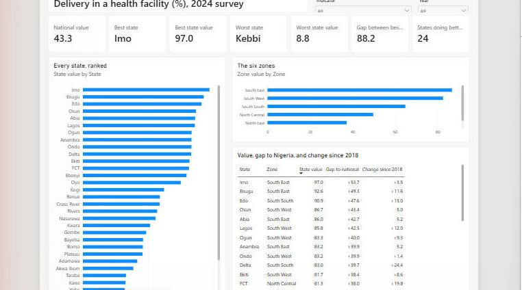
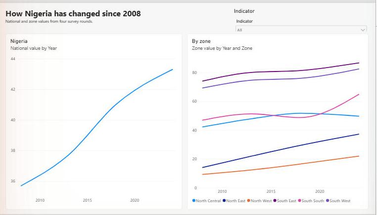
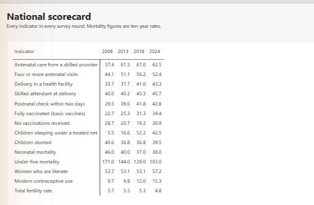
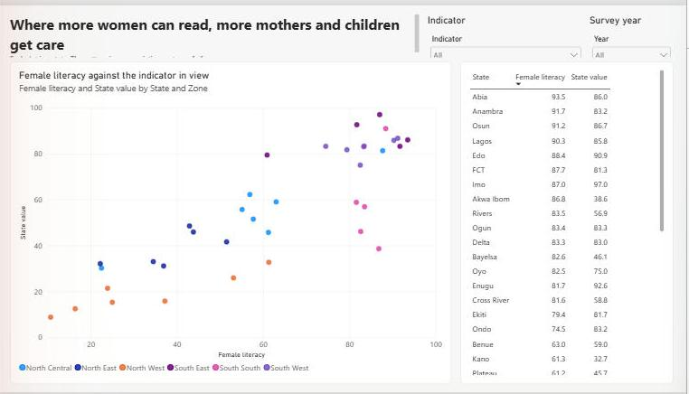

# Maternal and child health across Nigeria's states

**Where in Nigeria are mothers and children getting care, where are they not, and is the gap closing?**

A Power BI report on 14 indicators from four rounds of the Nigeria Demographic and Health Survey (2008, 2013, 2018 and 2024), for the country, its six zones, and its 36 states and the Federal Capital Territory.

`Power BI` · `DAX` · `Power Query` · `star schema` · `Python for extraction and checks` · `public health`

## The short answer

1. **Where a woman lives decides whether she gives birth with skilled care.** In 2024, 43% of births in Nigeria took place in a health facility. By state the figure runs from 97% in Imo to 9% in Kebbi.
2. **The national figure describes almost no state.** The median state is at 56%, and 24 of the 37 are above the national 43%. The national number is lower because the states with the lowest coverage carry more of the country's births.
3. **Progress is slow and uneven.** Facility delivery rose from 36% in 2008 to 43% in 2024, under half a point a year. The North East went from 14% to 37%; the North West from 9% to only 22%. Between 2018 and 2024 it fell in 11 states.
4. **Vaccination has split in two.** Between 2018 and 2024 the share of children fully vaccinated rose from 31% to 39%, while the share with no vaccination at all rose from 19% to 31%. In five states at least half of children have had none: Sokoto (84%), Kebbi (78%), Zamfara (73%), Kogi (54%) and Niger (51%).
5. **More children survive, but they are not better nourished.** Under-five mortality fell from 171 to 103 deaths per 1,000 live births across the four rounds. Stunting did not move: 41% in 2008, 40% in 2024.
6. **Female literacy tracks almost everything.** Across the 37 states in 2024, the share of women who can read correlates at +0.89 with skilled attendance at delivery and at -0.88 with child stunting.

## What I would recommend

Written for a programme lead deciding where to put the next round of effort.

| # | Action | Evidence |
|---|---|---|
| 1 | Plan by state, not by zone. | Facility delivery inside the North Central zone runs from 30% to 81%, and inside the South South from 39% to 91%. A zone average would misdirect resources in both. |
| 2 | Put delivery care in the North West first. | The zone is at 22%, with no state above 33%. It has gained 13 points in 16 years. |
| 3 | Treat zero-dose children as an emergency in five states. | Sokoto, Kebbi, Zamfara, Kogi and Niger are all at 50% or more. In Kebbi the share rose by 58 points since 2018. |
| 4 | Find out what happened in Kogi. | Since 2018: facility delivery down 9 points, four antenatal visits down 18, children with no vaccination up 44, stunting up 15. One state moving the wrong way on every measure deserves a visit before a conclusion. |
| 5 | Stop reporting progress with the national average alone. | A rising national figure can sit on top of 11 states going backwards. |

## The report

Four pages. One indicator and one survey year are in view at a time; with nothing selected the report shows delivery in a health facility for 2024.

### State comparison

Every state ranked, the six zones, and each state's gap to the national figure and change since 2018.



### Trends

The national line and the six zone lines across four survey rounds.



### National scorecard

Every indicator in every round, on one page.



### Literacy and care

Each state plotted by female literacy against the indicator in view.



## How it was built

| Step | File | What it does |
|---|---|---|
| 1 | [`scripts/01_fetch_dhs.py`](scripts/01_fetch_dhs.py) | Downloads the indicators from the DHS Program API and saves the responses unchanged, with a manifest of what was asked for and when. |
| 2 | [`scripts/02_build_model_tables.py`](scripts/02_build_model_tables.py) | Builds the seven tables the model reads, and refuses to write them if any data check fails. |
| 3 | [`powerbi/NigeriaMCH.pbip`](powerbi/NigeriaMCH.pbip) | The Power BI project: data model, measures and report pages, saved as text so every change shows up in version control. |

### Data model

```
Indicator (14) ──┬──< State values (1,554) >── State (37) >── Zone (6)
                 ├──< Zone values (336)    >──────────────── Zone
Survey (4) ──────┴──< National values (56)
```

Both `Indicator` and `Survey` filter all three fact tables.

### Four decisions that shaped the model

| Decision | Why |
|---|---|
| One fact table for each level: state, zone, national. | The survey publishes each level separately. Putting them in one table invites a total that adds a state to its own zone. A national value is not the sum or the average of the states. |
| One reference period per indicator. | The API returns maternal-care indicators for births in the last two, three and five years. I used the two-year window in every round, so rounds compare like with like. |
| The ten-year mortality rate at every level. | States are only published as ten-year rates. Showing the five-year national headline beside them would compare two different things. |
| State pages cover 2013, 2018 and 2024. | The 2008 round is published by zone only, so it appears in the zone and national trends and not in the state views. |

### The measure pattern

Every value measure follows one pattern: read what is selected, fall back to a sensible default, then fetch that one figure. The report therefore never shows an average across different indicators.

```dax
State value =
VAR SelectedIndicator = SELECTEDVALUE ( Indicator[Indicator ID], "RH_DELP_C_DHF" )
VAR SelectedYear = SELECTEDVALUE ( Survey[Year], 2024 )
RETURN
    CALCULATE (
        AVERAGE ( 'State values'[Value] ),
        REMOVEFILTERS ( Indicator ),
        Indicator[Indicator ID] = SelectedIndicator,
        REMOVEFILTERS ( Survey ),
        Survey[Year] = SelectedYear
    )
```

"Best" and "worst" depend on the indicator: a high value is good for vaccination and bad for stunting. Each indicator carries a direction (1, -1 or 0), and the comparison measures read it:

```dax
Best state value =
VAR Direction = [Indicator direction]
VAR StateTable = ADDCOLUMNS ( ALLSELECTED ( State[State] ), "@Value", [State value] )
VAR Target =
    IF ( Direction = -1, MINX ( StateTable, [@Value] ), MAXX ( StateTable, [@Value] ) )
RETURN
    Target
```

### How I know the numbers are right

- **Completeness.** 14 indicators × 3 rounds × 37 states = 1,554 state rows, with none missing. The zone and national tables reconcile the same way.
- **Consistency.** For every indicator in every round, the national figure lies between the lowest and the highest zone. The build script checks this and stops if it fails.
- **No recalculation.** Every figure in the report is a published survey estimate, shown as published. Nothing is re-weighted or averaged.
- **Tested with data.** Each page was opened and checked in Power BI Desktop after a full refresh.

## Limits of this analysis

- **These are survey estimates, not counts.** Each carries sampling error, and state figures carry more than national ones. The API publishes no confidence intervals for states, so a difference of a few points between two states, or between two rounds, may be noise.
- **State mortality rates are the least reliable figures here.** Deaths are rare events in a sample. A neonatal rate of 3 per 1,000 in one state is not credible as a true rate, and the report should not be used to rank states on mortality.
- **Correlation across states is not cause.** That states with more literate women have better outcomes does not show what would happen to one woman who learned to read.
- **Survey methods change between rounds.** The jump in children with no vaccination should be read against the 2024 survey report before it is quoted as a trend.
- **No state data for 2008** in the source.

## Run it yourself

Requirements: Python 3.10 or later (standard library only) and Power BI Desktop.

```bash
python scripts/01_fetch_dhs.py
python scripts/02_build_model_tables.py
```

Then open `powerbi/NigeriaMCH.pbip`. Under **Transform data > Edit parameters**, set `DataFolder` to the full path of your `data/model` folder, and click **Refresh**.

## Repository layout

```
data/raw/      API responses, unchanged, with a manifest
data/model/    the seven tables the report reads
scripts/       extraction and build scripts
powerbi/       the Power BI project (model and report as text)
docs/          page images
```

## Data source

ICF. The DHS Program Indicator Data API. https://api.dhsprogram.com (accessed 11 November 2026).

Surveys: Nigeria Demographic and Health Survey 2008, 2013, 2018 and 2023-24, National Population Commission (Nigeria) and ICF. Indicator values are reproduced as published.

Code in this repository: MIT licence.

## Author

**Elisha Abraham** is a healthcare and research data analyst with clinical training in nursing.
[LinkedIn](https://www.linkedin.com/in/elisha-abraham-a90569352) · [GitHub](https://github.com/elisha-abraham) · elishaabraham25@gmail.com
